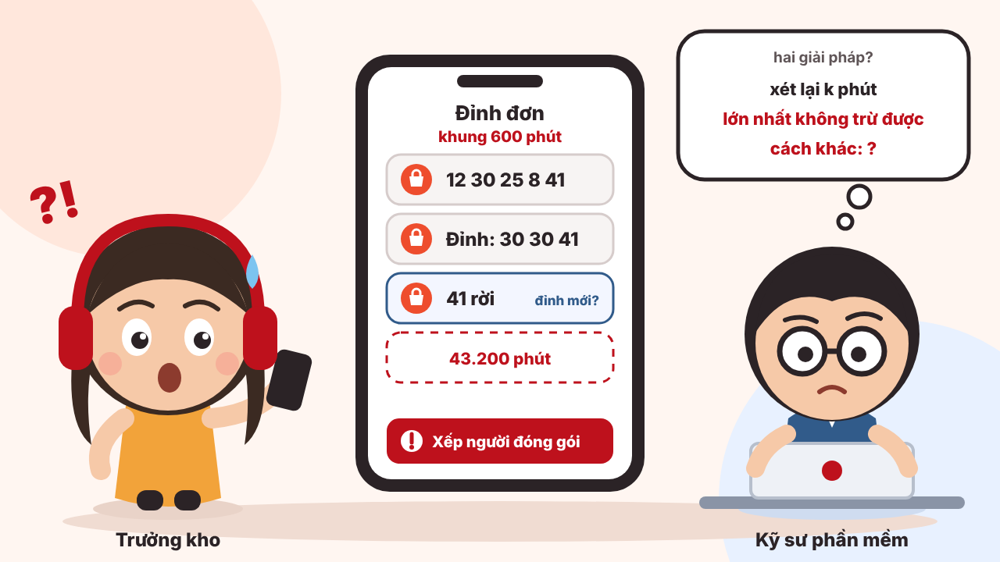

# Đỉnh số đơn theo khung giờ cho trưởng kho Tiki

### 1. Bối cảnh & Vấn đề



*Trưởng kho cần biết số đơn cao nhất trong mỗi khung k phút để xếp người đóng gói; dữ liệu một tháng theo từng phút làm báo cáo chạy rất lâu.*

Kho Tiki ghi **số đơn mới mỗi phút**. Để xếp người đóng gói, trưởng kho xem **đỉnh** (số đơn lớn nhất) trong từng khung **k phút liên tiếp**: khung bắt đầu ở phút 0, phút 1, phút 2... Số người cần trong khung phụ thuộc vào đỉnh, không phải tổng.

```plaintext
Số đơn mỗi phút: 12 30 25 8 41 19 7 33 33 10
Đỉnh từng khung 3 phút: 30 30 41 41 41 33 33 33
```

Báo cáo tháng có 43.200 phút (30 ngày × 24 giờ × 60 phút); nhóm muốn xem khung 600 phút (10 giờ) trong 2 giây. Cách đầu tiên là với mỗi khung, xét lại k phút để tìm lớn nhất: với khung dài, mỗi phút bị xét lại hàng trăm lần. Lưu ý: khác với **tổng** (khi khung trượt một phút chỉ cần trừ phút cũ, cộng phút mới), **lớn nhất** không "trừ" được; phút lớn nhất rời khung thì phải biết ngay phút lớn thứ hai trong khung là bao nhiêu. Trưởng nhóm yêu cầu bạn đề xuất ít nhất hai giải pháp, đo, so sánh rồi mới chọn.

### 2. Yêu cầu nghiệp vụ

**2.1. `window_max_v1(orders, k)` và `window_max_v2(orders, k)`**: mỗi hàm cài một giải pháp, trả về list đỉnh của từng khung theo thứ tự; `k <= 0` hoặc `k` lớn hơn số phút có dữ liệu thì trả list rỗng. Hai hàm cho cùng kết quả nhưng **khác nhau về cách làm**; không sửa list đầu vào.

**2.2. `peak_message(orders, k)`**: dùng giải pháp bạn chọn:

```plaintext
Khung 3 phút: đỉnh cao nhất 41 đơn (khung bắt đầu phút 2), đỉnh thấp nhất 30 đơn.
Chưa đủ dữ liệu cho khung 11 phút.
Độ dài khung phải lớn hơn 0.
```

Nhiều khung cùng đỉnh cao nhất thì ghi khung bắt đầu sớm nhất.

### 3. Edge Cases (Bẫy dữ liệu)

**Bẫy 1 — k bằng 1 và bằng số phút.** k = 1: đỉnh là chính dãy; k bằng số phút: một khung duy nhất.

**Bẫy 2 — k không hợp lệ, dữ liệu rỗng.** Trả list rỗng; thông báo đúng.

**Bẫy 3 — Giá trị bằng nhau.** `[5, 5, 5, 5]` với k = 2 cho `[5, 5, 5]`.

**Bẫy 4 — Dãy giảm dần.** Phút lớn nhất luôn rời khung trước: `[9, 7, 5, 3, 1]` với k = 2 cho `[9, 7, 5, 3]`.

**Bẫy 5 — Dữ liệu tháng.** 43.200 phút, khung 600 phút trong 2 giây.

**Kịch bản chạy thử.** Chạy `python dinh_don.py` (đoạn chạy thử có sẵn ở cuối tệp) phải in ra đúng:

```plaintext
[30, 30, 41, 41, 41, 33, 33, 33]
Khung 3 phút: đỉnh cao nhất 41 đơn (khung bắt đầu phút 2), đỉnh thấp nhất 30 đơn.
Khung 1 phút: đỉnh cao nhất 41 đơn (khung bắt đầu phút 4), đỉnh thấp nhất 7 đơn.
Chưa đủ dữ liệu cho khung 11 phút.
Độ dài khung phải lớn hơn 0.
Khung 600 phút: đỉnh cao nhất 210 đơn (khung bắt đầu phút 0), đỉnh thấp nhất 210 đơn.
```

### 4. Yêu cầu

Với vai trò kỹ sư phần mềm, bạn phải thực hiện đầy đủ ba phần sau:

**(1) Đề xuất và phân tích nhiều giải pháp (bắt buộc, viết vào `PHAN_TICH.md`)**

- Phân tích Input/Output của các hàm: kiểu dữ liệu đầu vào, giá trị trả về trong trường hợp thường và trong từng bẫy.
- Đề xuất **ít nhất hai giải pháp** khác nhau về cách làm cho việc tìm đỉnh từng khung. Với mỗi giải pháp: mô tả ý tưởng trong 2–3 câu, minh họa trên ví dụ ở mục 1, viết mã giả.
- Đo thời gian hai giải pháp bằng `timeit` với n = 43.200 phút và k = 60, 300, 600; ghi bảng số đo, phiên bản Python và máy đo. Đếm thêm số phép cộng hoặc số tham chiếu phải dịch bằng một biến đếm.
- So sánh các giải pháp theo bảng 5 tiêu chí: thời gian (Big-O), bộ nhớ phụ (Big-O), kết quả đo, độ dễ đọc và dễ bảo trì, mức phù hợp với bối cảnh của bài.
- Chọn giải pháp dùng cho `peak_message` và nêu lý do dựa trên bảng so sánh. Lựa chọn không có lý do không được tính điểm.

**(2) Chạy tay**

- Với mỗi giải pháp, chạy tay dãy ở mục 1 với k = 3: ghi dữ liệu trung gian (với giải pháp dùng cấu trúc phụ, ghi cấu trúc đó sau mỗi phút) và số phép so sánh.

**(3) Triển khai code**

- Viết thân ba hàm trong `dinh_don.py`. Không đổi tên hàm, tham số.
- Không sửa list đầu vào; giải pháp thứ hai không dùng `max()` trên lát cắt
- Xử lý đủ 5 bẫy ở mục 3; `python dinh_don.py` in đúng kịch bản chạy thử; `pytest -q` xanh cả 7 test có sẵn (các test về giải pháp chạy trên cả hai hàm `_v1`, `_v2`).
- Mã sạch, dễ đọc, tên biến theo snake_case, có chú thích nêu ý tưởng và độ phức tạp ở đầu mỗi hàm.

### 5. Quy định nộp bài

1. Tạo một kho GitHub riêng cho bài này, đặt tên theo mẫu `[Tên Lớp]_IT301_Session09_Ex14`.
2. Tải thư mục khởi đầu tại https://github.com/cuongtm191221/it301-bai-tap-ve-nha/tree/main/session-09-stack-queue-deque/bai-14 rồi chép các tệp vào kho: `dinh_don.py`, `test_dinh_don.py`, `PHAN_TICH.md`.
3. Điền phần phân tích vào `PHAN_TICH.md`, viết mã trong `dinh_don.py`.
4. Mức AI của bài: AI-0 (tự làm, không dùng AI).
5. Đưa bài làm lên kho và nộp đường dẫn kho lên hệ thống.
