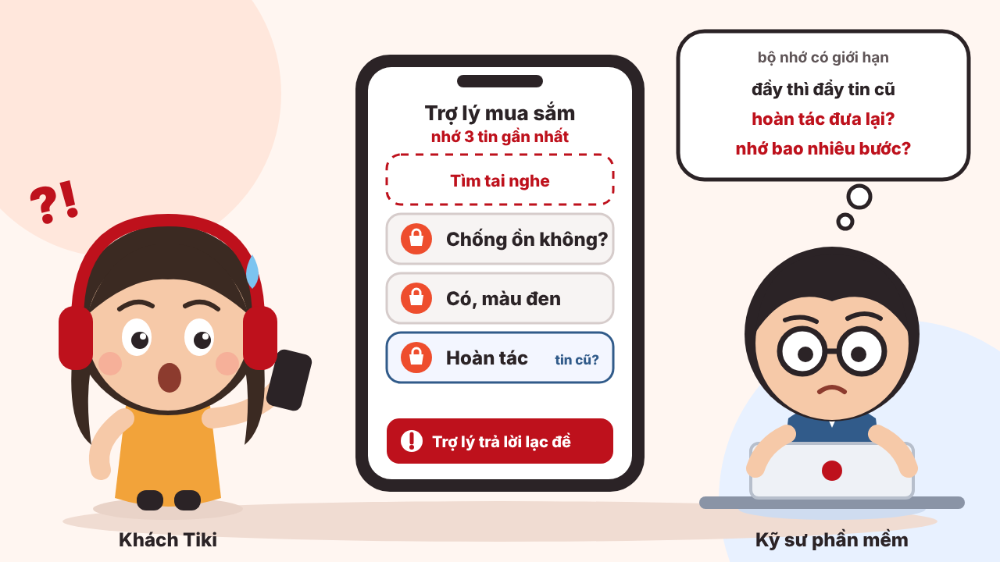

# Bộ nhớ hội thoại của trợ lý mua sắm Tiki

### 1. Bối cảnh & Vấn đề



*Trợ lý chỉ được gửi kèm vài tin gần nhất; khách bấm "hoàn tác" thì tin cũ đã bị đẩy ra phải quay lại đúng chỗ.*

Tiki thử nghiệm **trợ lý mua sắm**: khách gõ câu hỏi, trợ lý gợi ý sản phẩm. Mỗi lần khách hỏi, ứng dụng gửi kèm **ngữ cảnh** là các tin gần nhất của cuộc trò chuyện để trợ lý hiểu "màu đen" là nói về chiếc tai nghe nào. Gửi cả lịch sử thì chậm và tốn chi phí, nên ứng dụng chỉ giữ **`max_turns` tin gần nhất**; tin mới vào thì tin cũ nhất bị đẩy ra.

Khách hay gõ nhầm, nên nhóm sản phẩm thêm hai nút: **Hoàn tác** hủy tin vừa thêm (của khách hoặc của trợ lý), **Làm lại** đưa tin vừa hủy trở lại. Phiên bản thử nghiệm có lỗi khiến khách phàn nàn: bộ nhớ đầy, khách gõ một tin rồi bấm hoàn tác, thì tin bị xóa nhưng tin cũ đã bị đẩy ra lúc thêm **không quay lại**; ngữ cảnh mất một tin và trợ lý trả lời lạc đề.

Quy tắc của nhóm sản phẩm:

- Hoàn tác phải đưa bộ nhớ về **đúng** trạng thái trước lần thêm đó, kể cả đưa lại tin cũ bị đẩy ra (về đầu ngữ cảnh).
- Hoàn tác nhiều lần liên tiếp đi lùi từng bước; nhưng chỉ nhớ **`UNDO_LIMIT` = 50** lần thêm gần nhất, vì cuộc trò chuyện có thể dài hàng nghìn tin và điện thoại không được giữ lịch sử hoàn tác vô hạn.
- Làm lại chỉ dùng được ngay sau hoàn tác; khách thêm tin mới thì mất khả năng làm lại (giống mọi trình soạn thảo).

Bài này tổng hợp kiến thức cả buổi: deque giới hạn độ dài, thao tác ở cả hai đầu, hai stack hoàn tác / làm lại (bài 03), lưu đủ thông tin để đảo ngược một thao tác.

### 2. Yêu cầu nghiệp vụ

**2.1. `ChatMemory(max_turns)`**: `max_turns` là số nguyên dương, sai báo `ValueError("Số tin nhớ phải là số nguyên dương")`. Bạn tự thêm thuộc tính cần thiết.

**2.2. `add(role, text)`, `undo()`, `redo()`, `context()`**: như docstring; `undo`, `redo` trả về `True` / `False`; `context()` trả về list dòng `"<role>: <text>"`, tin cũ nhất trước.

**2.3. `run_commands(max_turns, commands)`**: chạy một list lệnh dạng chữ (`"user <text>"`, `"bot <text>"`, `"UNDO"`, `"REDO"`), bỏ qua lệnh lỗi, trả về ngữ cảnh cuối.

### 3. Edge Cases (Bẫy dữ liệu)

**Bẫy 1 — Bộ nhớ đầy.** Giữ đúng `max_turns` tin gần nhất; tin được lưu sau khi bỏ khoảng trắng hai đầu.

**Bẫy 2 — Hoàn tác khi bộ nhớ đầy.** Bộ nhớ 3 tin, đã thêm 5 tin: hoàn tác hai lần phải trở về đúng ba tin 0, 1, 2.

**Bẫy 3 — Không còn gì để hủy, để làm lại.** Trả `False`, không báo lỗi; thêm tin mới sau hoàn tác thì `redo()` trả `False`.

**Bẫy 4 — Dữ liệu sai.** `max_turns` là 0, âm, số thực, chuỗi, `True`; vai trò lạ; tin rỗng hoặc chỉ có khoảng trắng. Thêm lỗi thì không tạo bước hoàn tác nào.

**Bẫy 5 — Cuộc trò chuyện dài.** Thêm 80 tin rồi hoàn tác liên tục: hoàn tác được đúng 50 lần. 200.000 tin, cứ 10 tin hoàn tác rồi làm lại một lần, xong trong 2 giây.

**Kịch bản chạy thử.** Chạy `python tro_ly_chat.py` (đoạn chạy thử có sẵn ở cuối tệp) phải in ra đúng:

```plaintext
['bot: Có 12 mẫu, bạn thích chống ồn không?', 'user: Có, màu đen', 'bot: Gợi ý: SoundX Pro 459.000đ']
Hoàn tác: True ['user: Tìm tai nghe dưới 500 nghìn', 'bot: Có 12 mẫu, bạn thích chống ồn không?', 'user: Có, màu đen']
Làm lại: True ['bot: Có 12 mẫu, bạn thích chống ồn không?', 'user: Có, màu đen', 'bot: Gợi ý: SoundX Pro 459.000đ']
Làm lại sau khi thêm tin mới: False
['user: Xin chào']
```

### 4. Yêu cầu

Bạn phụ trách trọn tính năng và phải thực hiện đủ ba phần:

**(1) Phân tích và thiết kế (viết vào `PHAN_TICH.md`)**

- Input/Output của từng hàm, phương thức, trong trường hợp thường và trong từng bẫy.
- Một lần thêm khi bộ nhớ đầy làm thay đổi những gì? Mỗi bước hoàn tác cần lưu những thông tin nào để đảo ngược được đúng?
- Vẽ bộ nhớ (3 tin) và hai stack hoàn tác / làm lại qua từng lệnh của kịch bản chạy thử.
- Chọn cấu trúc cho bộ nhớ tin và cho lịch sử hoàn tác giới hạn 50 bước; thao tác nào cần ở đầu nào; vì sao list với `pop(0)`, `insert(0, ...)` không phù hợp khi `max_turns` lớn.
- Độ phức tạp: ghi Big-O thời gian của `add`, `undo`, `redo`, `context` theo k = `max_turns`, và bộ nhớ tối đa của toàn bộ đối tượng.

**(2) Triển khai code**

- Viết mã trong `tro_ly_chat.py`; được thêm thuộc tính, hàm phụ; không đổi tên và tham số đã có trong khung; hàm ghi "Có sẵn" giữ nguyên.
- Không dùng `pop(0)`, `insert(0, ...)` trên list; `add`, `undo`, `redo` không được sao chép cả bộ nhớ tin.
- Xử lý đủ 5 bẫy; `python tro_ly_chat.py` in đúng kịch bản chạy thử; `pytest -q` xanh cả 8 test có sẵn.

**(3) Nghiên cứu mở rộng (viết vào mục cuối của `PHAN_TICH.md`)**

- Tìm hiểu cách `collections.deque` được cài trong CPython (danh sách liên kết các khối, mã nguồn `Modules/_collectionsmodule.c` hoặc bài viết giải thích) và ý nghĩa tham số `maxlen`. Tìm hiểu `queue.Queue`: khác `deque` ở mục đích gì (hàng đợi giữa các luồng), khi đầy thì xử lý thế nào.
- Tạo `nghien_cuu.py`: đo bằng `timeit` thời gian giữ k tin gần nhất trong 200.000 tin bằng list (thêm cuối, `del data[0]` khi quá k) và bằng `deque(maxlen=k)`, với k = 100, 10.000, 100.000; minh họa `queue.Queue(maxsize=2)` khi đầy. Giải thích kết quả theo Big-O; trợ lý của Tiki nên dùng cấu trúc nào?
- Được tra cứu tài liệu và hỏi AI để tìm hiểu; phải ghi nguồn và viết lại bằng lời của bạn.

### 5. Quy định nộp bài

1. Tạo một kho GitHub riêng cho bài này, đặt tên theo mẫu `[Tên Lớp]_IT301_Session09_Ex19`.
2. Tải thư mục khởi đầu tại https://github.com/cuongtm191221/it301-bai-tap-ve-nha/tree/main/session-09-stack-queue-deque/bai-19 rồi chép các tệp vào kho: `tro_ly_chat.py`, `test_tro_ly_chat.py`, `PHAN_TICH.md`.
3. Viết mã trong `tro_ly_chat.py`, điền phần phân tích và phần nghiên cứu mở rộng vào `PHAN_TICH.md`. Tạo thêm `nghien_cuu.py` cho phần nghiên cứu.
4. Mức AI của bài: AI-0 cho phần phân tích và mã chính (tự làm, không dùng AI); AI-1 cho phần nghiên cứu mở rộng (được hỏi AI để tìm hiểu, phải ghi nguồn và tự kiểm chứng).
5. Đưa bài làm lên kho và nộp đường dẫn kho lên hệ thống.
