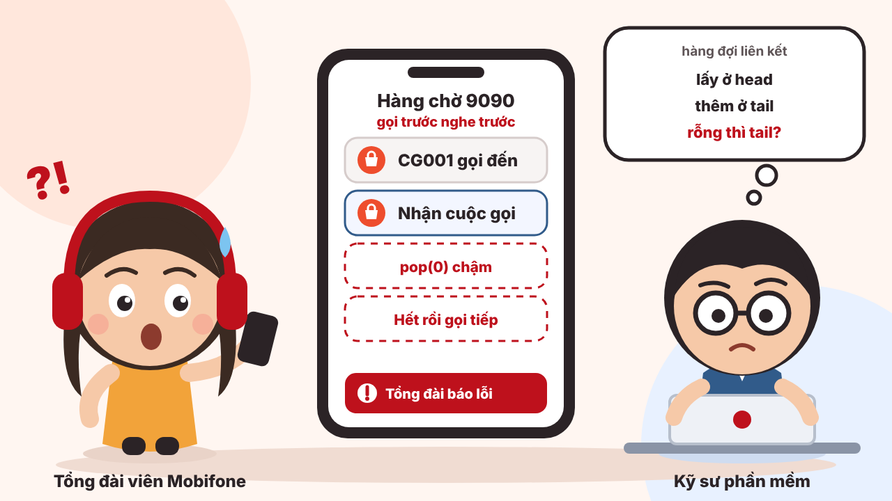

# Hệ thống hàng chờ cuộc gọi tổng đài Mobifone

### 1. Bối cảnh & Vấn đề



*Tổng đài viên Mobifone nhận cuộc gọi theo thứ tự*

Tổng đài chăm sóc khách hàng **Mobifone** xếp cuộc gọi vào **hàng chờ**: gọi trước được nghe trước. Mỗi cuộc gọi có mã `CGxxx` và số điện thoại; một số đang chờ mà gọi lại thì không xếp thêm lần nữa.

Bản cũ dùng list và `pop(0)`: giờ cao điểm hàng chờ dài, nhận cuộc gọi chậm dần; có lần nhận hết cuộc gọi rồi có cuộc gọi mới thì hệ thống báo lỗi. Đội kỹ thuật cài lại bằng **hàng đợi liên kết `LinkedQueue`** (`head`, `tail`, `_size`), mọi thao tác ở hai đầu không phải duyệt.

Bạn xây dựng module **"Mobifone Call Queue CLI"**.

### 2. Yêu cầu nghiệp vụ

Hàng chờ mẫu: `make_queue()` có 3 cuộc gọi. Lớp `Node`, hàm `waiting` có sẵn.

**Chức năng 1 — Xem hàng chờ** và `Đang chờ: <n> cuộc gọi`. **Chức năng 2 — Có cuộc gọi đến** (số 10 chữ số, bắt đầu bằng 0). **Chức năng 3 — Nhận cuộc gọi** đầu hàng.

**Chức năng 4 — Xem cuộc gọi tiếp theo** (không lấy ra). **Chức năng 5 — Thoát.**

`LinkedQueue` có `enqueue`, `dequeue`, `peek`, `is_empty`, `size`; lấy khi rỗng báo `IndexError("hàng đợi rỗng")`; không duyệt, không dùng list Python.

Màn hình mẫu (đoạn đầu; phím gõ vào hiện sau dấu hai chấm, `[menu chính]` là menu được in lại):

```plaintext
===== MOBIFONE - TỔNG ĐÀI 9090 =====
1. Xem hàng chờ
2. Có cuộc gọi đến
3. Nhận cuộc gọi
4. Xem cuộc gọi tiếp theo
5. Thoát
Chọn chức năng (1-5): 1
1. CG001 | 0901234567
2. CG002 | 0912000111
3. CG003 | 0388765432
Đang chờ: 3 cuộc gọi

[menu chính]
Chọn chức năng (1-5): 3
Đang nghe CG001 (0901234567).

[menu chính]
Chọn chức năng (1-5): 4
Tiếp theo: CG002 (0912000111)

[menu chính]
Chọn chức năng (1-5): 2
Số điện thoại: 0977555888
Đã xếp CG004 (0977555888), vị trí 3.

[... các lượt sau: thêm dữ liệu sai, nhập menu sai, thoát ...]
```

### 3. Edge Cases (Bẫy dữ liệu)

**Bẫy 1 — Nhận hết rồi có cuộc gọi mới.** Lấy phần tử cuối cùng phải đưa cả `head`, `tail` về `None`.

**Bẫy 2 — Xem không lấy ra.** Xem cuộc gọi tiếp theo hai lần vẫn cùng cuộc gọi, số đang chờ không đổi.

**Bẫy 3 — Số đang chờ gọi lại.** Báo lỗi; số đã được nghe xong thì gọi lại bình thường, mã mới không dùng lại.

**Bẫy 4 — Nhập sai.** Số thiếu, thừa chữ số, không bắt đầu bằng 0, có chữ; nhận khi hàng trống; menu sai.

### 4. Yêu cầu

**(1) Phân tích và thiết kế (viết vào `PHAN_TICH.md`)**

- Input/Output của từng chức năng, trong trường hợp thường và trong từng bẫy; luồng chương trình (mã giả hoặc các bước).
- Vẽ `head`, `tail` sau từng thao tác: nhận đến khi hết, rồi có cuộc gọi mới.
- Vì sao hàng đợi cần cả `head` và `tail`; Big-O của các phương thức; vì sao `list.pop(0)` không phù hợp khi hàng chờ dài.

**(2) Triển khai code**

- Viết các hàm trong `tong_dai.py` (giữ tên, tham số; hàm "Có sẵn" giữ nguyên) và chương trình menu trong `main.py`. Hàm nghiệp vụ không gọi `input()`, `print()`.
- Thông báo đúng từng chữ như đề; không dừng vì lỗi ở bất kỳ thao tác nào; tên biến snake_case, có chú thích.
- `python kiem_tra.py` đạt cả 4 mục (mục cuối tự chạy `main.py`, gõ một loạt lựa chọn có cả dữ liệu sai, và kiểm tra các thông báo của đề).

### 5. Quy định nộp bài

1. Tạo kho GitHub riêng, đặt tên `[Tên Lớp]_IT301_Session10_TH02`. Tải thư mục khởi đầu tại https://github.com/cuongtm191221/it301-bai-tap-ve-nha/tree/main/session-10-thuc-hanh-cli/bai-02 rồi chép các tệp vào kho: `tong_dai.py`, `main.py`, `kiem_tra.py`, `PHAN_TICH.md`.
2. Mức AI: AI-0 (tự làm, không dùng AI).
3. Đưa bài làm lên kho và nộp đường dẫn kho lên hệ thống.
