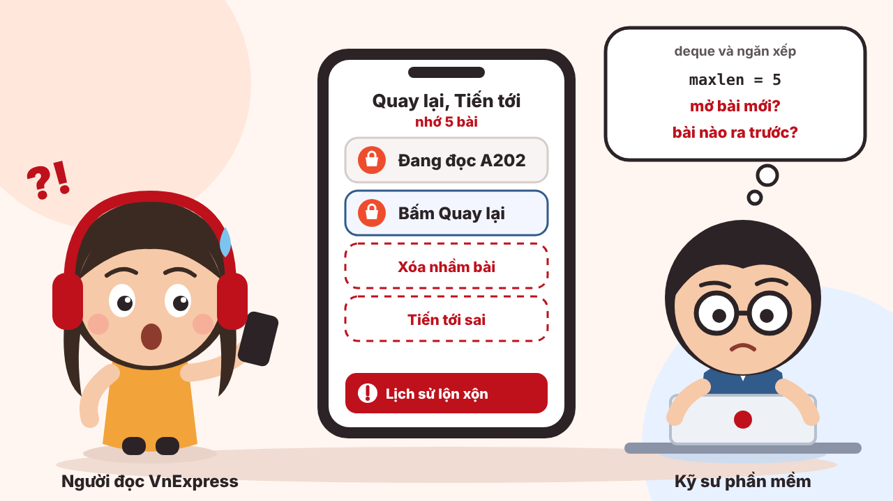

# Hệ thống nút Quay lại, Tiến tới của ứng dụng VnExpress

### 1. Bối cảnh & Vấn đề



*Người đọc VnExpress bấm Quay lại giữa các bài báo*

Ứng dụng đọc báo **VnExpress** có nút **Quay lại** và **Tiến tới** giữa các bài (mã `A` + 3 chữ số, trang chủ là `A100`). Quay lại mở bài vừa đọc trước đó; Tiến tới mở lại bài vừa rời đi bằng Quay lại; mở một bài mới thì không tiến tới được nữa. Để tiết kiệm bộ nhớ trên điện thoại, ứng dụng chỉ nhớ **5 bài** gần nhất để quay lại.

Bản cũ cắt lịch sử bằng cách xóa phần tử đầu list mỗi lần đầy, đôi khi xóa nhầm bài vừa đọc. Đội kỹ thuật dùng `deque(maxlen=5)` cho danh sách quay lại và một list làm **ngăn xếp** cho danh sách tiến tới.

Bạn xây dựng module **"VnExpress Back Forward CLI"**.

### 2. Yêu cầu nghiệp vụ

Lớp `Reader` (bắt đầu ở `A100`, `back` là `deque(maxlen=5)`, `forward` là list) và hàm `check_code` có sẵn.

**Chức năng 1 — Xem bài đang đọc.** **Chức năng 2 — Mở bài**: không mở lại đúng bài đang đọc. **Chức năng 3 — Quay lại.** **Chức năng 4 — Tiến tới.**

**Chức năng 5 — Xem lịch sử** (menu phụ): danh sách quay lại được hoặc tiến tới được, bài sẽ tới trước đứng trước; không có thì `(trống)`. **Chức năng 6 — Thoát.**

Màn hình mẫu (đoạn đầu; phím gõ vào hiện sau dấu hai chấm, `[menu chính]` là menu được in lại):

```plaintext
===== VNEXPRESS - ĐỌC BÁO =====
1. Xem bài đang đọc
2. Mở bài
3. Quay lại
4. Tiến tới
5. Xem lịch sử
6. Thoát
Chọn chức năng (1-6): 3
Lỗi: Không có bài để quay lại

[menu chính]
Chọn chức năng (1-6): 2
Mã bài: a201
Đang đọc: A201

[menu chính]
Chọn chức năng (1-6): 2
Mã bài: A202
Đang đọc: A202

[menu chính]
Chọn chức năng (1-6): 2
Mã bài: A202
Lỗi: Bạn đang đọc bài A202

[... các lượt sau: thêm dữ liệu sai, nhập menu sai, thoát ...]
```

### 3. Edge Cases (Bẫy dữ liệu)

**Bẫy 1 — Mở bài mới sau khi quay lại.** Danh sách tiến tới bị xóa sạch.

**Bẫy 2 — Đủ 5 bài.** Bài cũ nhất rơi khỏi danh sách quay lại; bài vừa đọc luôn được giữ.

**Bẫy 3 — Thứ tự.** Quay lại lấy bài gần nhất trước; Tiến tới lấy bài vừa rời đi trước.

**Bẫy 4 — Xem không làm đổi.** Xem lịch sử không làm đổi `back`, `forward`.

**Bẫy 5 — Nhập sai.** Mã sai dạng (gõ thường hợp lệ), mở lại bài đang đọc, quay lại/tiến tới khi không có; menu phụ và menu chính sai.

### 4. Yêu cầu

**(1) Phân tích và thiết kế (viết vào `PHAN_TICH.md`)**

- Input/Output của từng chức năng, trong trường hợp thường và trong từng bẫy; luồng chương trình (mã giả hoặc các bước).
- Vẽ `current`, `back`, `forward` sau từng thao tác của màn hình mẫu.
- Vì sao xóa phần tử đầu list mỗi lần đầy là chậm và dễ sai; `deque(maxlen=5)` làm gì khi `append` lúc đã đủ; Big-O các thao tác.

**(2) Triển khai code**

- Viết các hàm trong `doc_bao.py` (giữ tên, tham số; hàm "Có sẵn" giữ nguyên) và chương trình menu trong `main.py`. Hàm nghiệp vụ không gọi `input()`, `print()`.
- Thông báo đúng từng chữ như đề; không dừng vì lỗi ở bất kỳ thao tác nào; tên biến snake_case, có chú thích.
- `python kiem_tra.py` đạt cả 5 mục (mục cuối tự chạy `main.py`, gõ một loạt lựa chọn có cả dữ liệu sai, và kiểm tra các thông báo của đề).

### 5. Quy định nộp bài

1. Tạo kho GitHub riêng, đặt tên `[Tên Lớp]_IT301_Session10_TH04`. Tải thư mục khởi đầu tại https://github.com/cuongtm191221/it301-bai-tap-ve-nha/tree/main/session-10-thuc-hanh-cli/bai-04 rồi chép các tệp vào kho: `doc_bao.py`, `main.py`, `kiem_tra.py`, `PHAN_TICH.md`.
2. Mức AI: AI-0 (tự làm, không dùng AI).
3. Đưa bài làm lên kho và nộp đường dẫn kho lên hệ thống.
