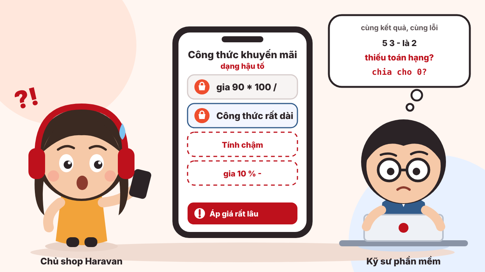

# Hệ thống công thức giá khuyến mãi dạng hậu tố của Haravan

### 1. Bối cảnh & Vấn đề



*Chủ shop nhập công thức khuyến mãi trên Haravan*

**Haravan** cho chủ shop tự nhập **công thức giá khuyến mãi** áp cho mọi sản phẩm. Để không phải xử lý ngoặc và thứ tự ưu tiên, công thức viết dạng **hậu tố**: toán tử đứng sau hai toán hạng, các phần cách nhau bằng khoảng trắng; `gia` là giá gốc, `/` là chia lấy phần nguyên. Ví dụ `gia 90 * 100 /` là giảm 10%, `gia 20000 -` là giảm 20.000đ.

Bản đầu tiên tính bằng cách lặp lại "tìm toán tử đầu tiên, tính với hai số đứng trước nó, ghép lại danh sách": đúng nhưng công thức dài (do hệ thống ghép nhiều chương trình khuyến mãi) thì chậm. Đội kỹ thuật cần hai giải pháp **cùng kết quả, cùng lỗi**, so sánh bằng số đo và phân tích.

Bạn xây dựng module **"Haravan Promo Formula CLI"**.

### 2. Yêu cầu nghiệp vụ

`Shop` (3 sản phẩm, công thức ban đầu `gia`), `to_tokens`, `apply`, `money` có sẵn.

**Chức năng 1 — Xem giá khuyến mãi** theo công thức hiện tại. **Chức năng 2 — Đổi công thức**: phải tính được cho mọi sản phẩm và không ra giá âm, không thì giữ công thức cũ.

**Chức năng 3 — Thử công thức với một giá** (menu phụ chọn giải pháp). **Chức năng 4 — Đo** với công thức n toán tử (n = 1.000, 2.000, 4.000). **Chức năng 5 — Thoát.**

`eval_v1`, `eval_v2` cho cùng kết quả, cùng lỗi (`Biểu thức không hợp lệ`, `Không chia được cho 0`), khác nhau về cách làm; giải pháp 2 tính công thức 200.001 phần trong 1 giây.

Màn hình mẫu (đoạn đầu; phím gõ vào hiện sau dấu hai chấm, `[menu chính]` là menu được in lại):

```plaintext
===== HARAVAN - CÔNG THỨC KHUYẾN MÃI =====
1. Xem giá khuyến mãi
2. Đổi công thức
3. Thử công thức với một giá
4. Đo so sánh hai giải pháp
5. Thoát
Chọn chức năng (1-5): 1
Công thức: gia
SP01 | Áo thun | 250.000đ -> 250.000đ
SP02 | Quần jean | 480.000đ -> 480.000đ
SP03 | Mũ lưỡi trai | 120.000đ -> 120.000đ

[menu chính]
Chọn chức năng (1-5): 2
Công thức: gia   90 * 100 /
Đã áp dụng: gia 90 * 100 /

[menu chính]
Chọn chức năng (1-5): 1
Công thức: gia 90 * 100 /
SP01 | Áo thun | 250.000đ -> 225.000đ
SP02 | Quần jean | 480.000đ -> 432.000đ
SP03 | Mũ lưỡi trai | 120.000đ -> 108.000đ

[... các lượt sau: thêm dữ liệu sai, nhập menu sai, thoát ...]
```

Chức năng 4 in dạng sau (máy soạn đề, Python 3.10):

```plaintext
n | giải pháp 1 (ms) | giải pháp 2 (ms)
1000 | 6.3 | 0.4
2000 | 23.1 | 0.8
4000 | 90.8 | 1.4
```

### 3. Edge Cases (Bẫy dữ liệu)

**Bẫy 1 — Thứ tự toán hạng.** `5 3 -` là 2, không phải -2; `10 3 /` là 3.

**Bẫy 2 — Thiếu, thừa toán hạng.** `gia +`, `1 2`, `+`, công thức trống: không hợp lệ.

**Bẫy 3 — Phần lạ.** `%`, số âm viết liền (`-5`): không hợp lệ.

**Bẫy 4 — Chia cho 0.** Báo theo thứ tự tính: `1 0 / +` là chia cho 0, `1 + 0 /` là không hợp lệ.

**Bẫy 5 — Nhập sai.** Công thức ra giá âm (giữ công thức cũ), giá gốc không phải số; menu phụ và menu chính sai.

### 4. Yêu cầu

**(1) Phân tích và thiết kế (viết vào `PHAN_TICH.md`)**

- Input/Output của từng chức năng, trong trường hợp thường và trong từng bẫy; luồng chương trình (mã giả hoặc các bước).
- Đề xuất hai giải pháp (ý tưởng, chạy tay trên `gia 3 + 2 * 1 - 4 /` với gia = 1.000, mã giả); với mỗi giải pháp, số phần tử bị duyệt, chép theo số phần n của công thức.
- Bảng so sánh 5 tiêu chí (tốc độ, bộ nhớ phụ, độ dễ đọc, dễ bảo trì, phù hợp bối cảnh) kèm số đo chức năng 4 trên máy bạn; chọn giải pháp và giải thích.

**(2) Triển khai code**

- Viết các hàm trong `cong_thuc.py` (giữ tên, tham số; hàm "Có sẵn" giữ nguyên) và chương trình menu trong `main.py`. Hàm nghiệp vụ không gọi `input()`, `print()`.
- Thông báo đúng từng chữ như đề; không dừng vì lỗi ở bất kỳ thao tác nào; tên biến snake_case, có chú thích.
- `python kiem_tra.py` đạt cả 7 mục (mục cuối tự chạy `main.py`, gõ một loạt lựa chọn có cả dữ liệu sai, và kiểm tra các thông báo của đề).

### 5. Quy định nộp bài

1. Tạo kho GitHub riêng, đặt tên `[Tên Lớp]_IT301_Session10_TH08`. Tải thư mục khởi đầu tại https://github.com/cuongtm191221/it301-bai-tap-ve-nha/tree/main/session-10-thuc-hanh-cli/bai-08 rồi chép các tệp vào kho: `cong_thuc.py`, `main.py`, `kiem_tra.py`, `PHAN_TICH.md`.
2. Mức AI: AI-0 (tự làm, không dùng AI).
3. Đưa bài làm lên kho và nộp đường dẫn kho lên hệ thống.
